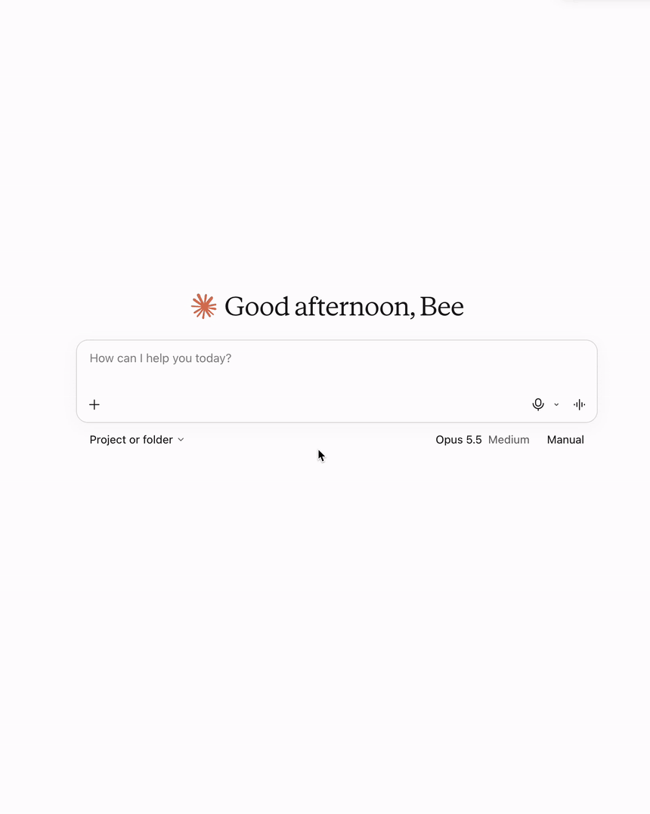
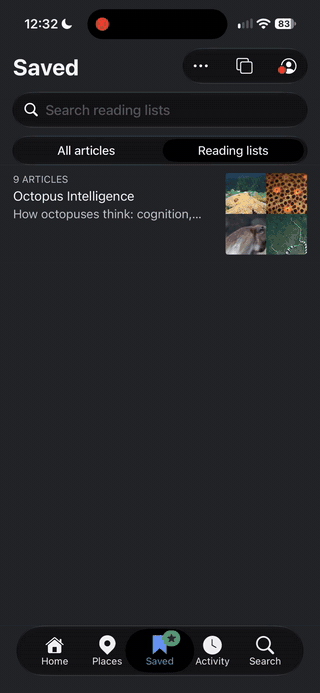
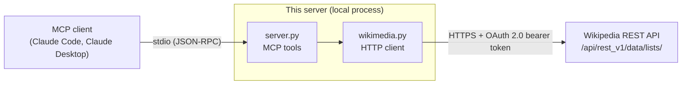

# Wikipedia Reading Lists MCP Server

An [MCP](https://modelcontextprotocol.io) server that connects Claude (or any
MCP client) to your Wikipedia reading lists: the "saved articles" you collect in
the Wikipedia apps.

The goal is to turn a conversation into reading. You talk through a topic with
Claude, and it can see what you've already saved and, as the project grows,
build a reading list in your Wikipedia account for you to pick up later on your
phone or in the browser.

<p align="center">
  
  
</p>

> **Status:** early and working. The server can read your lists and their
> articles, create new lists, add articles to them, and turn on the Reading
> Lists feature for your account. See the [roadmap](docs/ROADMAP.md) for
> details.

## What it can do

| Tool | What it does | Changes your account? |
|---|---|---|
| `list_reading_lists` | Returns every reading list on your account, with its id, name, and dates | No |
| `list_entries` | Returns every article on one list, by list id | No |
| `setup_reading_lists` | Turns on Wikipedia's Reading Lists feature for your account. Claude only calls it after asking you | Yes, once |
| `create_reading_lists` | Creates one or more empty lists, each with a name and an optional description. Names that already exist are left out and returned, so an existing list is never overwritten | Yes, adds lists |
| `create_list_entries` | Adds one or more articles to a list, by list id. Articles already on the list are left alone and marked as duplicates | Yes, adds articles |

A session might go like this:

> **You:** What have I saved about the Byzantine Empire?
>
> **Claude:** *(calls `list_reading_lists`, then `list_entries` on your
> "History" list)* You have four articles saved on it: Justinian I, the Nika
> riots, Hagia Sophia, and the Fourth Crusade…

Or, to turn a conversation into a new list:

> **You:** That was a great overview of how bird migration works. Can you
> save the articles you mentioned to a new reading list? Ten or so is plenty.
>
> **Claude:** Here's what I'd add to a new list called "Bird Migration":
> Bird migration, Arctic tern, Bar-tailed godwit, Magnetoreception, Flyway,
> Partial migration, Bird navigation, Zugunruhe, Ruby-throated hummingbird,
> and Bird ringing. Should I create it?
>
> **You:** Yes, go ahead.
>
> **Claude:** *(calls `list_reading_lists` to check the name is free, then
> `create_reading_lists`, then `create_list_entries` with the new list's id)*
> Done. "Bird Migration" is on your account with all ten articles, ready in
> the Wikipedia app.

Each tool's docstring is written as documentation for the model: what the tool
does, when to use it, and what the result means. That's how Claude decides
which tool fits a request.

## How it works



- **Transport:** the client starts the server as a child process and talks to
  it over stdin and stdout. Nothing listens on a network port.
- **Two layers:** `wikimedia.py` knows about HTTP and Wikimedia's API and
  nothing about MCP. `server.py` defines the tools and nothing about HTTP. The
  boundary between them is one exception type, `WikimediaAPIError`.
- **One shared client:** the server's lifespan opens a single `httpx2` client
  at startup and closes it on shutdown, so every tool call reuses the same
  connections ([ADR 0004](docs/decisions/0004-share-one-http-client-through-server-lifespan.md)).
- **Errors the model can act on:** failed requests become `WikimediaAPIError`
  with a stable code. A decorator on each tool converts them to MCP
  `ToolError`s and adds a next-step hint keyed by that code. For example, an
  account that hasn't turned on reading lists produces a message telling the
  model to ask the user before calling `setup_reading_lists`
  ([ADR 0005](docs/decisions/0005-convert-wikimedia-errors-to-tool-errors.md)).

## Design decisions

Each significant decision is recorded as an Architecture Decision Record (ADR)
in [`docs/decisions/`](docs/decisions/), with the context, the options
considered, and the tradeoffs.

| ADR | Decision | Why, in short |
|---|---|---|
| [0001](docs/decisions/0001-authenticate-with-owner-only-oauth2.md) | Authenticate with an owner-only OAuth 2.0 token | The simplest option that is scoped, revocable, and uses a standard bearer header, which leaves a path to a full OAuth flow later. Chosen over OAuth 1.0a, bot passwords, and a full OAuth flow |
| [0002](docs/decisions/0002-use-rest-api-for-reading-lists.md) | Use the REST API for reading lists | The Action API's reading-list modules are marked internal and "should not be used." The public `rest_v1` URL has a published spec and a maintainer commitment to keep it working |
| [0003](docs/decisions/0003-reading-list-setup-as-confirmed-mcp-tool.md) | Make setup a tool the model calls only with the user's consent, and never expose teardown | Setup writes to the user's account; teardown would delete every list and entry, with no use case here |
| [0004](docs/decisions/0004-share-one-http-client-through-server-lifespan.md) | Share one HTTP client through the server lifespan | Reuses connections across calls and closes the client reliably, using the mechanism the MCP SDK provides |
| [0005](docs/decisions/0005-convert-wikimedia-errors-to-tool-errors.md) | Convert Wikimedia errors to tool errors with next-step hints | The MCP SDK forwards only `ToolError` messages to the client. A decorator keeps the SDK out of the HTTP layer, and catching only network errors and timeouts keeps real bugs visible as crashes |
| [0006](docs/decisions/0006-filter-duplicate-names-when-creating-lists.md) | Leave out existing names when creating lists, and return them to the model | The API silently overwrites the description of a list with the same name. Filtering on the server protects the user's data without relying on the model, and keeps the tool's non-destructive annotation accurate |

Some things learned along the way are recorded in the ADRs too. Bearer-token
writes need no CSRF token. Calling setup twice is harmless. Creating a list
with an existing name updates that list instead of failing. Adding articles
in a batch isn't all-or-nothing: if one fails, the ones before it are kept.
Wikimedia's error
responses come in several shapes (JSON, plain text, and HTML from the CDN), so
the error parser decides the format from the body's fields rather than from
`Content-Type`.

## Getting started

### Requirements

- Python 3.13 or later and [uv](https://docs.astral.sh/uv/)
- A Wikipedia account
- An MCP client, such as [Claude Code](https://code.claude.com) or Claude
  Desktop

### 1. Get an access token

1. Go to
   [Special:OAuthConsumerRegistration/propose/oauth2](https://meta.wikimedia.org/wiki/Special:OAuthConsumerRegistration/propose/oauth2)
   on Meta-Wiki while logged in.
2. Choose **"This consumer is for use only by [your username]"** (owner-only).
3. Set the applicable project to English Wikipedia (`enwiki`), and grant
   **Basic rights** and **Access private information**. Reading lists are
   private, so the second grant is required.
4. Submit, and copy the access token it shows you. It's shown once.

### 2. Install

```bash
git clone https://github.com/benJrohrer/wikipedia-reading-lists-mcp.git
cd wikipedia-reading-lists-mcp
uv sync
cp .env.example .env
```

Put your token in `.env`:

```
WIKIMEDIA_ACCESS_TOKEN=your-token-here
```

`.env` is ignored by git. The server loads it from the project folder, so it
works no matter which directory your MCP client starts it from.

To check the token, run the smoke test. It prints your username and your lists
to stderr:

```bash
uv run python src/wikipedia_reading_lists_mcp/wikimedia.py
```

### 3. Connect it to your client

#### Claude Code

**Claude Code**, from the project folder:

```bash
claude mcp add --transport stdio wikipedia-reading-lists -- \
  uv run --directory "$PWD" wikipedia-reading-lists-mcp
```

Then start `claude`, run `/mcp` to confirm the server is connected, and ask
about your reading lists.

#### Other MCP clients:

```json
{
  "mcpServers": {
    "wikipedia-reading-lists": {
      "command": "uv",
      "args": [
        "run",
        "--directory",
        "/absolute/path/to/wikipedia-reading-lists-mcp",
        "wikipedia-reading-lists-mcp"
      ]
    }
  }
}
```

If your reading lists aren't set up yet, the first call returns an error that
tells Claude to ask you before turning the feature on. Say yes and it will call
`setup_reading_lists`.

## Development

```bash
uv sync                                                    # install dependencies
uv run mcp dev src/wikipedia_reading_lists_mcp/server.py   # open in the MCP Inspector
```

The [MCP Inspector](https://github.com/modelcontextprotocol/inspector) lets you
list and call the tools by hand and see the raw JSON-RPC messages.

To test with a different environment (for example, a bad token), call the
Inspector directly, since `mcp dev` can't pass environment variables:

```bash
npx @modelcontextprotocol/inspector -e WIKIMEDIA_ACCESS_TOKEN=notarealtoken \
  uv run --directory "$PWD" python src/wikipedia_reading_lists_mcp/server.py
```

Conventions:

- **Never print to stdout.** It carries the MCP protocol; logs go to stderr.
- **Never commit credentials.** Tokens live in `.env` or the environment.
- **Commit messages follow [Conventional Commits](https://www.conventionalcommits.org).**
- **New decisions get an ADR,** using
  [`0000-template.md`](docs/decisions/0000-template.md).

### Project layout

```
src/wikipedia_reading_lists_mcp/
    server.py      # MCP server: tools, error-to-ToolError decorator, hints
    wikimedia.py   # HTTP client, auth, pagination, Wikimedia error parsing
docs/
    ROADMAP.md     # current status, next steps, dated progress log
    decisions/     # architecture decision records
.env.example       # the settings the server needs
CLAUDE.md          # project context for Claude Code sessions
```

## Limitations

- **One user, one wiki.** The owner-only token belongs to one account and, as
  registered, works only on English Wikipedia. Using it for other people means
  each person registering their own token, or the full OAuth flow listed under
  the roadmap.
- **Nothing can be removed yet.** The server can create lists and add
  articles, but can't delete either, or change a list's description.
- **No automated tests yet.** Error handling has been checked by hand through
  the Inspector, against a live account. A test suite with mocked Wikimedia
  responses is planned ([#1](https://github.com/benJrohrer/wikipedia-reading-lists-mcp/issues/1)).
- **The API itself is marked unstable.** Wikimedia has committed to avoid
  breaking the public reading-lists URL, but it could change
  ([ADR 0002](docs/decisions/0002-use-rest-api-for-reading-lists.md)).

## Roadmap

Current status, next steps, and a dated log of what was built and learned are
in [`docs/ROADMAP.md`](docs/ROADMAP.md). Work items are tracked as
[GitHub issues](https://github.com/benJrohrer/wikipedia-reading-lists-mcp/issues).

Next up: deciding how the model should choose the size of a new list
([#6](https://github.com/benJrohrer/wikipedia-reading-lists-mcp/issues/6)),
then the test suite. Further out, a hosted version with a full OAuth flow would
let anyone connect their own account without creating a token by hand.

## How this was built

I built this project to sharpen my development skills, and to learn AI-assisted development deliberately: every design decision and its tradeoffs are mine, and Claude served as a collaborator and reviewer.

- **Design came first.** Each decision was talked through in Claude Code's plan
  mode, where it can research and discuss but not edit, and then written up by
  me as an ADR.
- **Learning mode for the code.** Claude Code's Learning output style leaves
  the decisions with real tradeoffs (error handling, API behavior, data
  shapes) for me to write, and explains the code it writes itself.
- **Every change reviewed.** I approved each edit as a diff instead of letting
  changes apply automatically, and used Claude as a reviewer for code I wrote.
- **Verified against the real API.** Behavior the docs didn't settle, such as
  whether writes need a CSRF token or what happens on a second setup call, was
  tested against a live account and recorded in the ADRs.

The [commit history](https://github.com/benJrohrer/wikipedia-reading-lists-mcp/commits),
the ADRs, and the roadmap's progress log show how the project developed.

## License

MIT. See [LICENSE](LICENSE).
